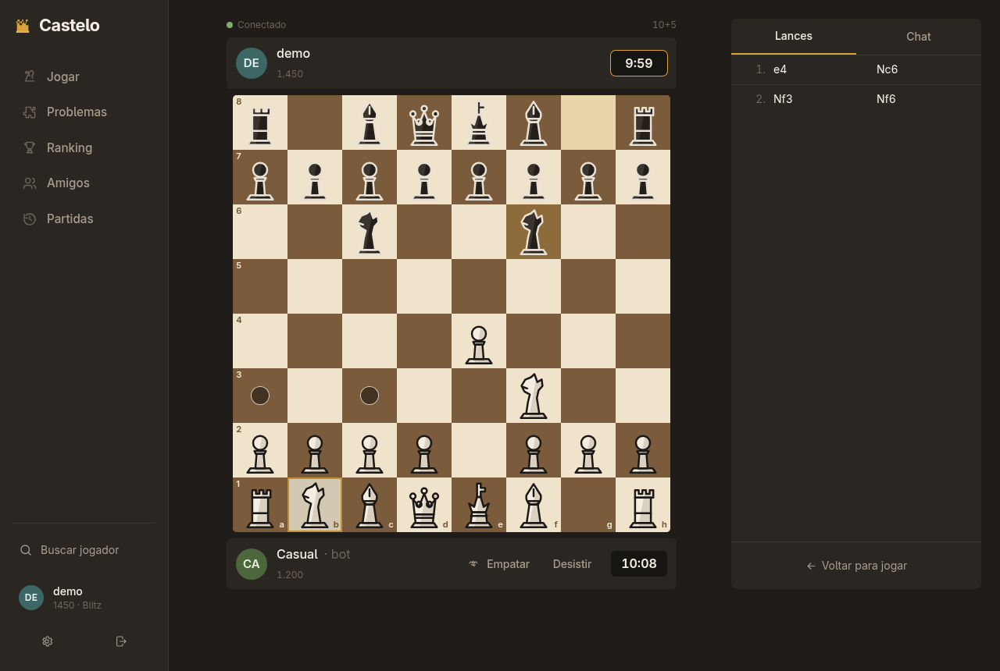
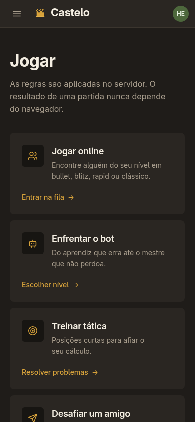
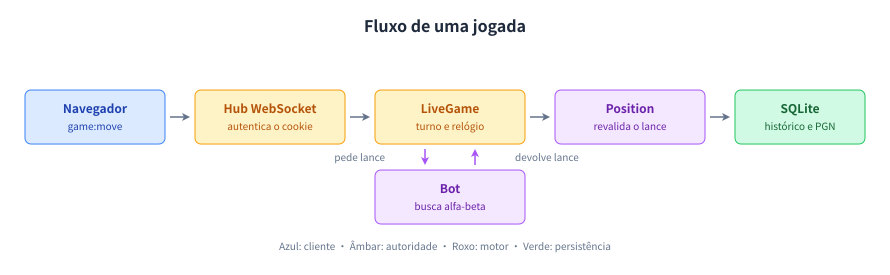

# Castelo

Plataforma de xadrez online: jogue contra pessoas em tempo real, treine tática com problemas,
enfrente um bot com busca alfa-beta de verdade e reveja cada partida em PGN.

As regras são aplicadas no servidor. O navegador desenha o tabuleiro — ele nunca decide o
resultado de um jogo.


## O que já funciona

| Recurso | Situação |
|---|---|
| Cadastro, login, recuperação de senha | Funcionando |
| Perfil público com ratings e estatísticas | Funcionando |
| Tabuleiro interativo com lances legais | Funcionando |
| Partida contra o bot (4 níveis) | Funcionando |
| Partida online em tempo real (WebSocket) | Funcionando |
| Matchmaking por rating e formato | Funcionando |
| Relógio com incremento (bullet/blitz/rapid/clássico) | Funcionando |
| Histórico, replay lance a lance e PGN | Funcionando |
| Ranking por categoria | Funcionando |
| Problemas de xadrez com rating e validação no servidor | Funcionando |
| Lista de amigos, desafios e aceite na interface | Funcionando |
| Configurações de conta, tabuleiro e som (Web Audio) | Funcionando |
| Layout responsivo (360px, 768px, 1440px) | Funcionando |

## Partida contra o bot

O bot roda no servidor com busca negamax, Principal Variation Search, tabela de transposição,
killer moves, histórico, redução de lance tardio e quiescência. A avaliação soma material, posição
por casa, estrutura de peões, torre em coluna aberta e escudo do rei.

A busca usa um tabuleiro interno próprio, com make/unmake: o `chess.js` gera dois FEN por lance e
custa ~856µs, o que limitava a busca à profundidade 4. Com o gerador próprio — validado por `perft`
contra o `chess.js` em seis posições de referência — o motor chega a ~1 milhão de nós em 3
segundos.

Os quatro níveis não jogam lance aleatório. Cada um tem uma margem de erro em centipontos: o bot
escolhe entre os lances aceitáveis, o que produz erro humano em vez de erro absurdo. O aprendiz abre
com 1.b4 e ignora material, mas não pendura a rainha.



## Tela de cellphone

A barra lateral vira menu superior e o conteúdo ocupa a largura toda.



## Como rodar

Requisitos: Node 22 ou superior (o projeto usa `node:sqlite`, que é nativo do Node).

```bash
npm install
npm run db:reset -w @castelo/server   # cria o schema
npm run seed -w @castelo/server       # usuários e partidas de demonstração
npm run dev                            # sobe a API (:4000) e o front (:5173)
```

Abra <http://localhost:5173>.

O seed cria três contas de demonstração com a senha `Castelo#2026!` (`demo`, `ana`, `bruno`) e seis
partidas clássicas com PGN real — inclusive a famouslya Opera Game de Morphy.

### Outros comandos

```bash
npm run build        # compila engine, shared, server e web
npm run typecheck    # TypeScript estrito em todos os pacotes
npm test             # 66 testes: 45 do engine, 21 do servidor
npm run db:reset -w @castelo/server   # apaga e recria o banco
```

## Arquitetura

Monorepo com workspaces npm. Três pacotes, quatro responsabilidades:

```
castelo/
├─ packages/shared     tipos e schemas zod compartilhados entre web e servidor
├─ packages/engine     regras de xadrez, relógio, Elo, PGN e o bot — puro e síncrono
├─ apps/server         Fastify + node:sqlite + WebSocket (ws)
└─ apps/web            React 19 + Vite + Tailwind CSS v4
```



### Onde cada decisão mora

- **As regras ficam no engine.** O `packages/engine` não importa nada de `node:*` nem faz I/O, então
  o mesmo código valida o lance no servidor e desenha a alternativa legal no navegador.
- **O servidor é a autoridade.** Cada lance recebido passa por `Position.move()`, que revalida o
  lance contra a posição atual. Lance ilegal, partida encerrada ou jogada fora de turno são
  recusados com erro — nunca corrigidos no cliente.
- **O relógio é do servidor.** O cliente só estima o tempo entre eventos; quem cobra o tempo
  esgotado é o servidor, com um varredor periódico.
- **As partidas vivem em memória e são persistidas a cada lance.** `LiveGame` guarda o estado
  autoritativo; o banco guarda o histórico para análise.
- **A camada de dados é isolada em `repos/`.** Trocar `node:sqlite` por Postgres significa reescrever
  um diretório, não a aplicação.

### Fluxo de uma jogada

```
navegador ──WS game:move──▶ hub ──▶ LiveGame.applyMove()
                                        │
                                        ├─ Position.move() revalida o lance
                                        ├─ relógio debita e aplica incremento
                                        ├─ fim de partida? resultado e motivo
                                        └─ persistência no SQLite
                              │
navegador ◀──WS game:move───┴── game.emit() para os dois jogadores
```

## Segurança

- **Senhas** com scrypt (`N=2^15, r=8, p=1`), salt aleatório por senha e comparação em tempo
  constante.
- **Sessões** com token de 32 bytes aleatórios. O banco guarda apenas o SHA-256 do token; o token
  cru vive só em cookie `HttpOnly`, `SameSite=Lax`, `Secure` em produção.
- **CSRF** por double-submit: toda rota mutativa exige o header `X-CSRF-Token`, comparado em tempo
  constante com o token da sessão.
- **Validação no servidor** com zod em toda entrada. O cliente valida apenas para dar retorno
  visual rápido.
- **Rate limiting** por IP: 10 requisições a cada 5 minutos em `/api/auth/*`, 120 por minuto nas
  jogadas e 300 por minuto no resto da API.
- **SQL sempre parametrizado.** Nenhuma concatenação de valores na consulta.
- **CSP restritiva** via helmet, `frame-ancestors: 'none'`, `object-src: 'none'`.
- **Sem segredos no repositório.** `.env.example` documenta as variáveis; o servidor falha na
  inicialização se `SESSION_SECRET` estiver ausente em produção.

## Testes

```bash
npm test
```

- `packages/engine` — 45 testes: contagem de lances legais, xeque-mate, stalemate, material
  insuficiente, round-trip de FEN e PGN, simetria do Elo, débito e incremento do relógio, e
  garantia de que o bot devolve sempre um lance legal. Mais 23 testes de `perft` que comparam o
  gerador de lances do bot com o `chess.js` em seis posições de referência, e a checagem de que
  make/unmake devolve o tabuleiro exatamente ao estado anterior.
- `apps/server` — 21 testes: hash e verificação de senha, criação e destruição de sessão, registro,
  duplicidade, login por usuário e por e-mail, 401 sem sessão, 403 sem CSRF, 404 canônico, ausência
  de e-mail no perfil público e o ciclo completo de autenticação com cookie e CSRF.

Os fluxos de interface foram verificados com Playwright: cadastro pela tela, criação de partida
contra o bot, jogada completa com resposta do bot, relógios correndo e lista de lances preenchida.

## Movimento

A interface usa transições de transform e opacidade com tokens próprios: entrada de página ao trocar
de rota, feedback de pressão nos botões, deslizamento das peças no tabuleiro e atualização suave das
anotações das lições. `prefers-reduced-motion` desliga todos os deslocamentos. Os efeitos sonoros são
sintetizados com Web Audio, sem arquivos de áudio externos.

## Design

**Arquivo de Xadrez**, uma direção editorial de museu: pergaminho, marinho e ouro antigo. Dois temas
com a mesma linguagem:

- **Arquivo** (claro): fundo `#E9E0CC`, superfície `#F3ECDD`, tinta `#27231F`, ação `#142B4A`
- **Arquivo Noturno** (escuro): fundo `#171A18`, superfície `#212622`, tinta `#EFE8D8`, ação `#D4B276`

O alternador fica na barra lateral, no rodapé da gaveta móvel e em Configurações → Aparência. Sem
escolha manual, o site segue a preferência do sistema. O tema é aplicado antes do primeiro paint e
persiste em `localStorage`.

Identidade visual própria, desenhada a partir da análise do Chess.com registrada em
[`docs/ANALISE-REFERENCIA.md`](docs/ANALISE-REFERENCIA.md) — a estrutura (grid de 4px, escala de
tokens semântica, cabeçalho de 48px, coordenadas dentro das casas, cards que explicam para quem a
opção serve), não a aparência.

- Superfícies separadas por passo de tom, nunca por linha ou sombra. O ouro antigo aparece só no
  glifo da marca e em detalhes; as ações usam o azul-marinho no tema claro e o latão no escuro.
- Sem gradientes, sem emoji e sem sombra em repouso: a separação vem da cor.
- Tabuleiro "Nogueira" por padrão, com Esmeralda, Ardósia e Gelo disponíveis nas configurações.
- Peças em SVG original, desenhadas para este projeto.
- Space Grotesk para display e relógio, com fallback de sistema para o corpo do texto.

## Documentação

- [`docs/ANALISE-REFERENCIA.md`](docs/ANALISE-REFERENCIA.md) — o que foi medido no Chess.com e as
  decisões de design do Castelo.
- [`docs/CONTRATO.md`](docs/CONTRATO.md) — o contrato técnico entre os pacotes: API do engine,
  schema do banco, rotas HTTP e protocolo WebSocket.
- [`docs/DECISOES.md`](docs/DECISOES.md) — desvios e decisões registradas durante a construção.

## Licença

MIT. Projeto independente, sem vínculo com Chess.com ou qualquer outro serviço de xadrez.
